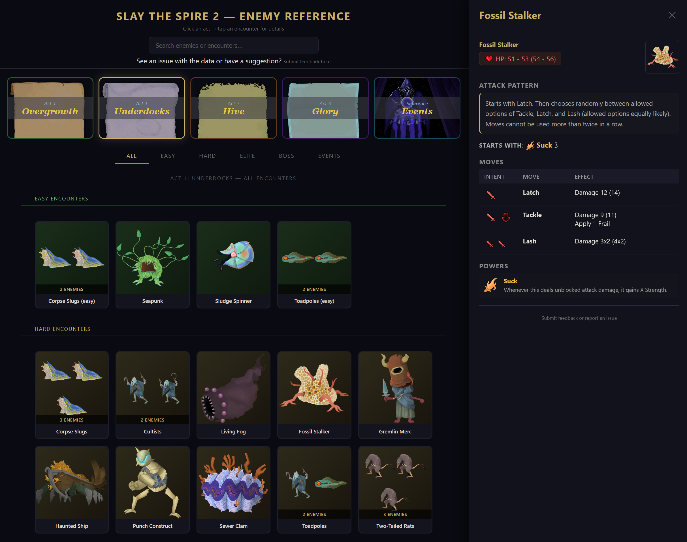
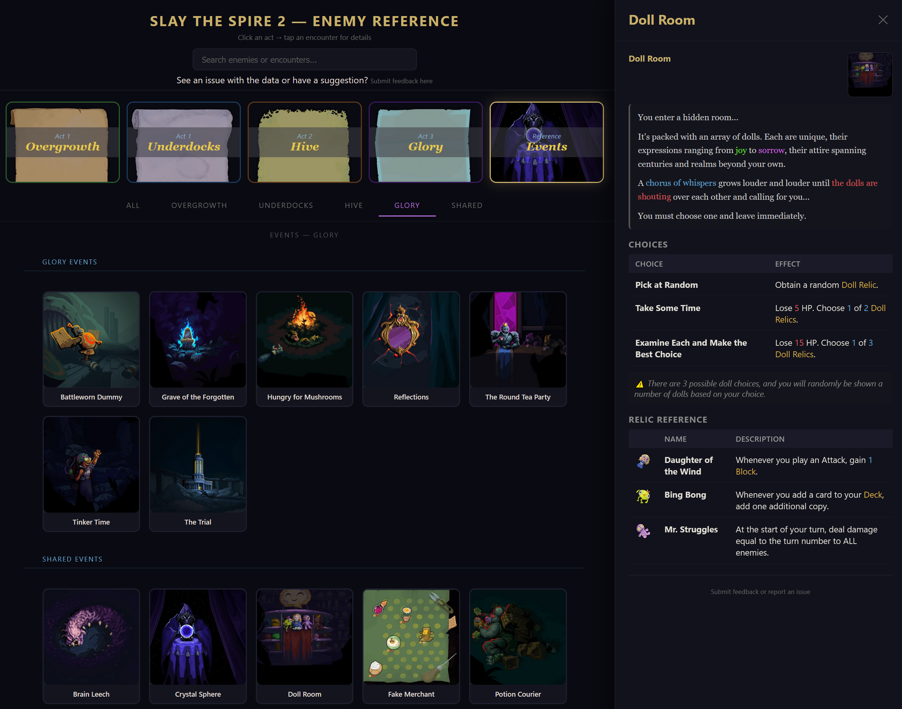

# STS2 Enemy Reference

An unofficial reference guide for **Slay the Spire 2**. Look up enemy attack patterns, event outcomes, and item details without leaving your run.

**[Open the Guide →](https://spirecodex.com/)**

---

## Enemies

Easily look up enemy details. Every enemy's full attack cycle, HP range, and status powers — organized by act and type so you can find what you need fast.

## Events

Easily reference event information for each of the acts. Event outcomes are laid out clearly, with the exact cards, relics, potions, and enchantments you'll gain or lose — plus lore text animated the same way it appears in the game.

## Link settings

Any page link can preset the display settings, e.g. `spirecodex.com/beta/enemy/ruby-raider-brute/?players=3&dread=1&boss=vantom`. They apply to that visit only, and the address bar then keeps tracking your settings so you can copy it to share exactly what you see.

| Parameter | Values |
|---|---|
| `players` | `1`–`4` |
| `act` | `overgrowth`, `underdocks`, `hive`, `glory` or `events`. Also sets which act an enemy that appears in several acts is scaled for. |
| `dread` | `1` or `0` (beta, when the patch has Dread mode) |
| `boss` | Act boss keys, comma-separated, one per act (Dread only). Acts left out use their first boss. |
| `enemies` | Encounter pages only: enemy keys, comma-separated, e.g. `/encounter/ruby-raiders/?enemies=ruby-raider-axe,ruby-raider-brute,ruby-raider-tracker`. Shows just those enemies. Pool encounters also have a picker for this. |

---

All game assets and data belong to [Mega Crit](https://www.megacrit.com/). This is an unofficial fan project, not affiliated with or endorsed by Mega Crit. Enemy patterns are kept current with the latest game patch — the exact version is shown in the site's banner and footer.
